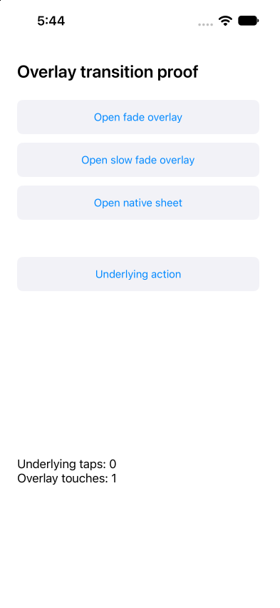

# ✗ UIKit fade 750ms (repeat #2)

`tests/overlay.e2e.ts` · failed · 14.1s

Ran on: platform `ios` · device `<run-or-owned-device-id>`

**ASSERTION_FAILED**

```text
expect.toHaveText failed
locator: getByTestId("results")
expected: text "Underlying taps: 1\nOverlay touches: 0"
observed: text "Underlying taps: 0 Overlay touches: 1" (match count 1)
```

Look at: `tests/overlay.e2e.ts:14`  

## Steps

1. ✓ `device.openApp` `dev.e2e.overlay1563` (1.8s, video 0:00) — `tests/overlay.e2e.ts:10`
2. ✓ `locator.tap` `getByRole("button", name: "Open fade overlay")` (2.6s, video 0:01) — `tests/overlay.e2e.ts:11`
   - tap button "Open fade overlay" (2.6s)
   - screen: 12 nodes at `dev.e2e.overlay1563`
3. ✓ `locator.tap` `getByRole("button", name: "Close overlay")` (2.4s, video 0:04) — `tests/overlay.e2e.ts:12`
   - tap button "Close overlay" (2.4s)
   - screen: 3 changes since step 2 at `dev.e2e.overlay1563`, 15 nodes
     - `added text "Fade duration: 0.75 s"`
     - `added button "Close overlay" testid="Close overlay"`
     - `added text "Close overlay"`
4. ✓ `locator.tap` `getByRole("button", name: "Underlying action")` (365ms, video 0:06) — `tests/overlay.e2e.ts:13`
   - tap button "Underlying action" (365ms)
   - screen: 3 changes since step 3 at `dev.e2e.overlay1563`, 12 nodes
     - `removed text "Fade duration: 0.75 s"`
     - `removed button "Close overlay" testid="Close overlay"`
     - `removed text "Close overlay"`
5. ✗ `expect.toHaveText` `getByTestId("results")` (5.0s, video 0:07) — **ASSERTION_FAILED** — `tests/overlay.e2e.ts:14`
   - expect gave up after 37 reads in 5.0s: text "Underlying taps: 0 Overlay touches: 1" (1 match) x37
   - screen: 2 changes since step 4 at `dev.e2e.overlay1563`, 12 nodes
     - `added text "Underlying taps: 0\nOverlay touches: 1" text="Underlying taps: 0 Overlay touches: 1" testid="results"`
     - `removed text "Underlying taps: 0\nOverlay touches: 0" text="Underlying taps: 0 Overlay touches: 0" testid="results"`

## Screen at failure

`dev.e2e.overlay1563` · viewport 393x852 · 12 nodes  



The screen as the agent reads it, one node per line: `#id role "name" text="…" [states]`.

```text
#root screen
 #n1416 application "OverlayFixture"
  #n1417 text "Overlay transition proof"
  #n1418 button "Open fade overlay" testid="Open fade overlay"
   #n1419 text "Open fade overlay"
  #n1420 button "Open slow fade overlay" testid="Open slow fade overlay"
   #n1421 text "Open slow fade overlay"
  #n1422 button "Open native sheet" testid="Open native sheet"
   #n1423 text "Open native sheet"
  #n1424 button "Underlying action" testid="Underlying action"
   #n1425 text "Underlying action"
  #n1426 text "Underlying taps: 0\nOverlay touches: 1" text="Underlying taps: 0 Overlay touches: 1" testid="results"
```

## Evidence

- [screenshot](attempt-1/screenshots/001-failure.png) `evidence/main-2000/results/overlay-uikit-fade-750ms-4b8a8a661670c5f1/attempt-1/screenshots/001-failure.png`
- [screen](attempt-1/screen-at-failure.txt) `evidence/main-2000/results/overlay-uikit-fade-750ms-4b8a8a661670c5f1/attempt-1/screen-at-failure.txt`
- [video](attempt-1/video/video.mp4) `evidence/main-2000/results/overlay-uikit-fade-750ms-4b8a8a661670c5f1/attempt-1/video/video.mp4`

<sub>e2e 0.23.0 · run `<run-or-owned-device-id>` · the whole run is in `report.json`</sub>
