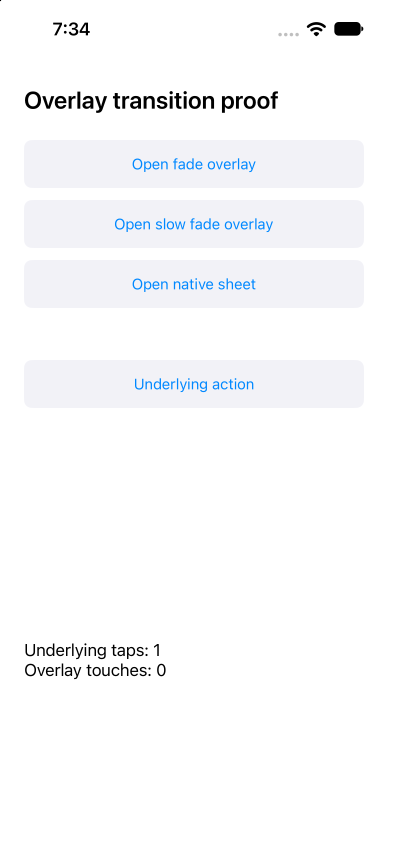

# ✗ short action timeout during native overlay dismissal

`tests/timeout.e2e.ts` · failed · 10.3s

Ran on: platform `ios` · device `<run-or-owned-device-id>`

**ACTION_FAILED**

```text
tap timed out before the device answered; its input may have been dispatched: getByRole("button", name: "Underlying action")
```

Look at: `tests/timeout.e2e.ts:6`  

## Steps

1. ✓ `device.openApp` `dev.e2e.overlay1563` (1.8s, video 0:00) — `tests/timeout.e2e.ts:3`
2. ✓ `locator.tap` `getByRole("button", name: "Open slow fade overlay")` (1.5s, video 0:01) — `tests/timeout.e2e.ts:4`
   - tap button "Open slow fade overlay" (1.5s)
   - screen: 12 nodes at `dev.e2e.overlay1563`
3. ✓ `locator.tap` `getByRole("button", name: "Close overlay")` (1.5s, video 0:03) — `tests/timeout.e2e.ts:5`
   - tap button "Close overlay" (1.5s)
   - screen: 3 changes since step 2 at `dev.e2e.overlay1563`, 15 nodes
     - `added text "Fade duration: 3.0 s"`
     - `added button "Close overlay" testid="Close overlay"`
     - `added text "Close overlay"`
4. ✗ `locator.tap` `getByRole("button", name: "Underlying action")` (503ms, video 0:04) — **ACTION_FAILED** — `tests/timeout.e2e.ts:6`
   - ✗ tap button "Underlying action": **ACTION_FAILED**
   - screen: 3 changes since step 3 at `dev.e2e.overlay1563`, 12 nodes
     - `removed text "Fade duration: 3.0 s"`
     - `removed button "Close overlay" testid="Close overlay"`
     - `removed text "Close overlay"`

## Screen at failure

`dev.e2e.overlay1563` · viewport 393x852 · 12 nodes  



The screen as the agent reads it, one node per line: `#id role "name" text="…" [states]`.

```text
#root screen
 #n62 application "OverlayFixture"
  #n63 text "Overlay transition proof"
  #n64 button "Open fade overlay" testid="Open fade overlay"
   #n65 text "Open fade overlay"
  #n66 button "Open slow fade overlay" testid="Open slow fade overlay"
   #n67 text "Open slow fade overlay"
  #n68 button "Open native sheet" testid="Open native sheet"
   #n69 text "Open native sheet"
  #n70 button "Underlying action" testid="Underlying action"
   #n71 text "Underlying action"
  #n72 text "Underlying taps: 1\nOverlay touches: 0" text="Underlying taps: 1 Overlay touches: 0" testid="results"
```

## Evidence

- [screenshot](attempt-1/screenshots/001-failure.png) `framework-main-timeout/results/timeout-short-action-timeout-during-ca5b231a9f10da20/attempt-1/screenshots/001-failure.png`
- [screen](attempt-1/screen-at-failure.txt) `framework-main-timeout/results/timeout-short-action-timeout-during-ca5b231a9f10da20/attempt-1/screen-at-failure.txt`
- [video](attempt-1/video/video.mp4) `framework-main-timeout/results/timeout-short-action-timeout-during-ca5b231a9f10da20/attempt-1/video/video.mp4`

<sub>e2e 0.23.0 · run `<run-or-owned-device-id>` · the whole run is in `report.json`</sub>
