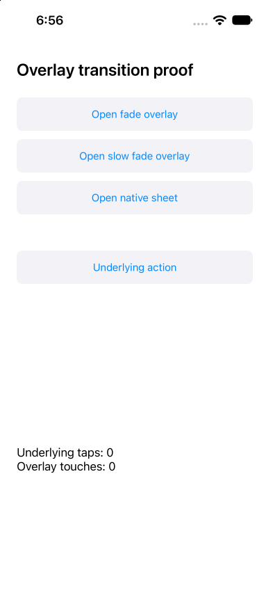

# ✗ UIKit fade 750ms

`tests/overlay.e2e.ts` · failed · 5.0s

Ran on: platform `ios` · device `<run-or-owned-device-id>`

**ENGINE_FAILURE**

```text
perform tap failed: Refusing to clean AGENT_DEVICE_IOS_RUNNER_DERIVED_PATH automatically Hint: Unset AGENT_DEVICE_IOS_CLEAN_DERIVED, or move AGENT_DEVICE_IOS_RUNNER_DERIVED_PATH under a subdirectory of <verification-root>/.tmp.
```

Look at: `mobile/dist/errors.js:206`  

## Steps

1. ✓ `device.openApp` `dev.e2e.overlay1563` (1.8s, video 0:00) — `tests/overlay.e2e.ts:10`
2. ✗ `locator.tap` `getByRole("button", name: "Open fade overlay")` (1.2s, video 0:01) — **ENGINE_FAILURE** — `tests/overlay.e2e.ts:11`
   - ✗ tap button "Open fade overlay": **ENGINE_FAILURE**
   - screen: 12 nodes at `dev.e2e.overlay1563`

## Screen at failure

`dev.e2e.overlay1563` · viewport 393x852 · 12 nodes  



The screen as the agent reads it, one node per line: `#id role "name" text="…" [states]`.

```text
#root screen
 #n23 application "OverlayFixture"
  #n24 text "Overlay transition proof"
  #n25 button "Open fade overlay" testid="Open fade overlay"
   #n26 text "Open fade overlay"
  #n27 button "Open slow fade overlay" testid="Open slow fade overlay"
   #n28 text "Open slow fade overlay"
  #n29 button "Open native sheet" testid="Open native sheet"
   #n30 text "Open native sheet"
  #n31 button "Underlying action" testid="Underlying action"
   #n32 text "Underlying action"
  #n33 text "Underlying taps: 0\nOverlay touches: 0" text="Underlying taps: 0 Overlay touches: 0" testid="results"
```

## Evidence

- [screenshot](attempt-1/screenshots/001-failure.png) `e2e-candidate/results/overlay-uikit-fade-750ms-80d4a79d51bf9965/attempt-1/screenshots/001-failure.png`
- [screen](attempt-1/screen-at-failure.txt) `e2e-candidate/results/overlay-uikit-fade-750ms-80d4a79d51bf9965/attempt-1/screen-at-failure.txt`
- [video](attempt-1/video/video.mp4) `e2e-candidate/results/overlay-uikit-fade-750ms-80d4a79d51bf9965/attempt-1/video/video.mp4`

<sub>e2e 0.23.0 · run `<run-or-owned-device-id>` · the whole run is in `report.json`</sub>
