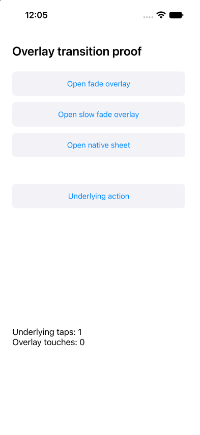

# ✗ expired pending press stays unsent after fade completion

`tests/timeout-observe.e2e.ts` · failed · 18.2s

Ran on: platform `ios` · device `<owned-simulator>`

**ASSERTION_FAILED**

```text
expect.toHaveText failed
locator: getByTestId("results")
expected: text "Underlying taps: 0\nOverlay touches: 0"
observed: text "Underlying taps: 1 Overlay touches: 0" (match count 1)
```

Look at: `tests/timeout-observe.e2e.ts:13`

## Steps

1. ✓ `device.openApp` `dev.e2e.overlay1563` (2.7s, video 0:00) — `tests/timeout-observe.e2e.ts:4`
2. ✓ `locator.tap` `getByRole("button", name: "Open slow fade overlay")` (1.7s, video 0:02) — `tests/timeout-observe.e2e.ts:5`
   - tap button "Open slow fade overlay" (1.7s)
   - screen: 12 nodes at `dev.e2e.overlay1563`
3. ✓ `locator.tap` `getByRole("button", name: "Close overlay")` (1.6s, video 0:04) — `tests/timeout-observe.e2e.ts:6`
   - tap button "Close overlay" (1.6s)
   - screen: 3 changes since step 2 at `dev.e2e.overlay1563`, 15 nodes
     - `added text "Fade duration: 3.0 s"`
     - `added button "Close overlay" testid="Close overlay"`
     - `added text "Close overlay"`
4. ✗ `locator.tap` `getByRole("button", name: "Underlying action")` (502ms, video 0:05) — **ACTION_FAILED** — `tests/timeout-observe.e2e.ts:8`
   - ✗ tap button "Underlying action": **ACTION_FAILED**
   - screen: 3 changes since step 3 at `dev.e2e.overlay1563`, 12 nodes
     - `removed text "Fade duration: 3.0 s"`
     - `removed button "Close overlay" testid="Close overlay"`
     - `removed text "Close overlay"`
5. ✗ `expect.toHaveText` `getByTestId("results")` (5.0s, video 0:09) — **ASSERTION_FAILED** — `tests/timeout-observe.e2e.ts:13`
   - expect gave up after 37 reads in 5.0s: text "Underlying taps: 1 Overlay touches: 0" (1 match) x37
   - screen: 2 changes since step 4 at `dev.e2e.overlay1563`, 12 nodes
     - `added text "Underlying taps: 1\nOverlay touches: 0" text="Underlying taps: 1 Overlay touches: 0" testid="results"`
     - `removed text "Underlying taps: 0\nOverlay touches: 0" text="Underlying taps: 0 Overlay touches: 0" testid="results"`

## Screen at failure

`dev.e2e.overlay1563` · viewport 393x852 · 12 nodes



The screen as the agent reads it, one node per line: `#id role "name" text="…" [states]`.

```text
#root screen
 #n469 application "OverlayFixture"
  #n470 text "Overlay transition proof"
  #n471 button "Open fade overlay" testid="Open fade overlay"
   #n472 text "Open fade overlay"
  #n473 button "Open slow fade overlay" testid="Open slow fade overlay"
   #n474 text "Open slow fade overlay"
  #n475 button "Open native sheet" testid="Open native sheet"
   #n476 text "Open native sheet"
  #n477 button "Underlying action" testid="Underlying action"
   #n478 text "Underlying action"
  #n479 text "Underlying taps: 1\nOverlay touches: 0" text="Underlying taps: 1 Overlay touches: 0" testid="results"
```

## Evidence

- [screenshot](failure.png) `runner-proof/results/timeout-observe-expired-pending-press-stays-20e0da70d66ef3ef/failure.png`
- [screen](screen-at-failure.txt) `runner-proof/results/timeout-observe-expired-pending-press-stays-20e0da70d66ef3ef/screen-at-failure.txt`
- [video](video.mp4) `runner-proof/results/timeout-observe-expired-pending-press-stays-20e0da70d66ef3ef/video.mp4`

<sub>e2e 0.23.0 · run `01a1c8ff-2c3a-7af6-9cac-b120b97f1756` · the whole run is in `report.json`</sub>
